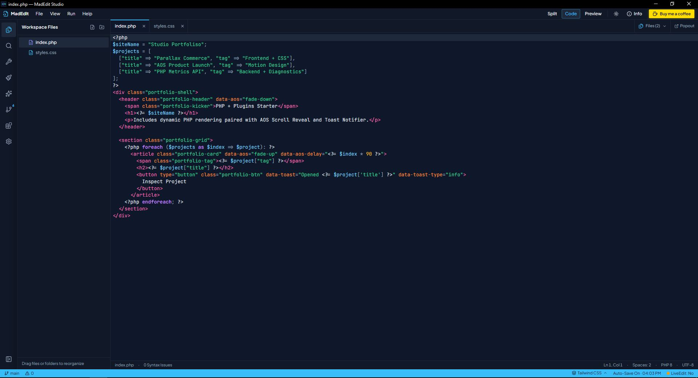

# MadEdit Studio

**Ship interfaces and PHP scripts without friction.**

MadEdit Studio (v1.0.3) is a fast, distraction-free web and PHP editor built for developers who want instant visual feedback and Notepad++ muscle memory—without heavy Electron bloat or complex build pipelines[cite: 1, 5, 6].



---

## Key Features

- **Live Split Preview & Click-to-Source Inspect**: Edit HTML, CSS, JS, and PHP side-by-side[cite: 1, 9]. Enable **Inspect** mode and click any element in the preview pane to jump straight to its source line[cite: 1].
- **Independent Preview Modes**: Toggle **Light** and **Dark** preview themes independently from your editor theme, and switch between **Desktop** and **Tablet (768px)** viewports in one click[cite: 1].
- **CSS & Class Previewer (All-Files Batch Action)**: Scan your workspace for Tailwind utilities, colors, border radii, and classes—then **Edit All**, **Add All**, or **Delete All** tokens across your entire project at once[cite: 10].
- **Code Healer**: Real-time diagnostics across HTML, CSS, JS, PHP, and TXT that automatically detect and repair unclosed tags, malformed attributes, and syntax issues[cite: 1, 9].
- **Notepad++ Keybindings**: Familiar shortcuts out of the box (`Ctrl+D` to duplicate line, `Ctrl+L` to delete line, `Ctrl+Q` to toggle comment, `Ctrl+Shift+U` for uppercase, `F5` to run PHP / refresh preview).
- **Chrome Live Reload (Bundled v3.0.0)**: Built-in reload server on port `5500` paired with a local Chrome extension that automatically refreshes open browser tabs whenever files change.
- **Theme Engine & Color Studio**: Includes 8 built-in presets (*Obsidian Slate*, *Monokai Carbon*, *Dracula Official*, *GitHub Dark*, *Steam Classic Green*, *WhatsApp Dark*, and more) with full `.xml` and `.json` theme import/export.
- **Built-in Version Control & Snippets**: Stage snapshots, switch branches, and insert reusable HTML5, CSS, Bootstrap 5, AOS, and JS DOM snippets directly at your cursor[cite: 2, 3].
- **Offline Ready**: Auto-saves locally and runs as a Windows desktop app or installable PWA[cite: 1].

---

## Getting Started

### Desktop / Local Server (PHP)
1. Clone the repository:
   ```bash
   git clone [https://github.com/YOUR_USERNAME/madedit-studio.git](https://github.com/YOUR_USERNAME/madedit-studio.git)
